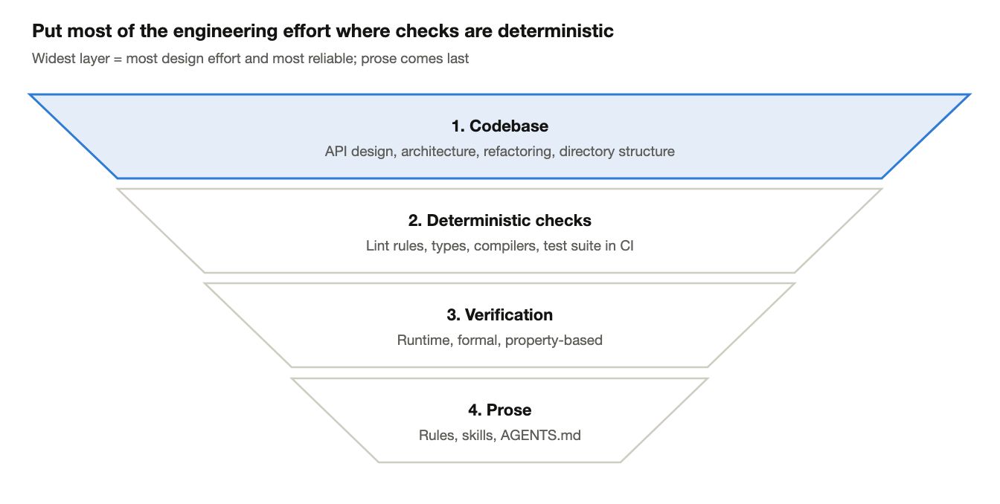

# From Slop to Gold: A Guide to Trusting Your Coding Agents

*As of November 17, 2026.*

## TL;DR

You can ship agent-written code at huge volume without losing quality, but only once you can **trust** your agents' environment. That trust is built in code, not in prompts.

- **The new job of a software engineer:** keep or raise code quality while massively raising output.
- **Every correction to an agent becomes a deterministic check** (lint rule, type, test, API change), not another line in AGENTS.md.
- **Your codebase is the agent's biggest input.** Agents copy what they see, so keep it pristine: no workarounds, no dead patterns, almost no comments.
- **Review shifts to verification artifacts:** evidence that the code works (recordings, logs, test reports, state charts, proofs), not line-by-line diffs.
- **Automate last.** Automating a loop that produces slop only produces more slop, at a higher token bill.

Source: ["All Code Is Slop (Except Mine)"](https://www.youtube.com/watch?v=O_zcc6Xl12g), a talk by Lauren Tan ("poteto"), engineer on the Grok Bot team at SpaceXSI, given at [AI Engineer Code 2026](https://ai.engineer/code/2026/talks/lauren-tan). Internal names (the Dune framework, the Bombadil tool) are as heard in the talk; check the recording before quoting them. The talk's examples come from one desktop app built with TypeScript, React and Electron. This guide states each idea so it applies to any codebase, and keeps the talk's example as an illustration.

## The trust pyramid

Trust here is not blind faith. It is investment in the agent's environment until you can count on it to do the right thing by default. The speaker ranks where to spend that investment as an inverted pyramid.



Layers 1 and 2 constrain agents in code, so the right thing is the default. Layer 3 finds bugs and checks the agent understood your intent. Layer 4 covers only what needs judgment.

A layer's width is the engineering effort you put into it, not the tokens it uses. Layer 1 takes the most design work. Layer 3 uses the most tokens, because agents run verification on every change (see Layer 3).

## Layer 1: Treat the codebase as a garden

Agents generate output from their inputs, and your code is the largest input. Whatever is in it, good or bad, looks like "the established pattern" and gets copied.

Code used to arrive a few PRs at a time (3 to review in 2024); now it is closer to 300. It behaves like a living, continuous stream. Your constraints are the concrete foundation that new code grows around. Tech debt, workarounds and deprecated code are weeds: left alone, they spread everywhere.

### Patterns that work

1. **Ban anything that needs nuance to use well.** Nuance leads to slop. Wrap each such API in one owned abstraction and forbid direct use everywhere else. The whole class of misuse then leaves code review for good.
   - Typical candidates in any stack: raw threads and locks, hand-built SQL or shell strings, manual memory or resource handling, global mutable state, reflection and dynamic eval.
   - In the talk: React's `useEffect` is banned in product code and allowed only inside the in-house framework's APIs.
2. **Encode context in the directory structure.** Name top-level folders after the boundaries that matter, then forbid imports that cross them. Common boundaries: client and server, domain and infrastructure, public API and internals, one service and another.
   - In the talk: agents imported Electron main-process code into the renderer, causing long tasks and jank. Two top-level folders named after the two processes, plus import rules, ended it.
3. **Ban (almost) all comments.** Agents use comments, docs and Markdown to justify not doing the right thing. They also over-rotate on one small correction and treat it as law. Comments go stale, humans skip them, and nothing enforces them; the speaker's team bans about 99% of them.
   - The ban targets comments that explain or excuse how the code works. Keep what serves readers outside the code: reference docs for a public API (docstrings, JSDoc, rustdoc), license and legal headers, notes a regulator or compliance process requires, and markers that tools read, such as build tags or generated-file headers.
   - Watch for quick fixes that paper over a design problem: sleeps, timers, retries, catch-all exception handlers, flags that skip a check. Each tends to arrive with a comment explaining why it is fine.
   - In the talk: agents patched a clash between VS Code's imperative core and React's declarative style with timers (`setTimeout`, `requestAnimationFrame`, `requestIdleCallback`), each with a justifying comment. Timers spread, garbage collection spiked, the app lagged.
4. **Fix the architecture, not the symptom.** When agents keep reaching for hacks, the design is usually fighting them. A better API or architecture removes the problem categorically.

Put these constraints where every change passes through them: a shared framework, core modules or a project template. In the talk they live in an in-house framework, Dune, which is technically ordinary. Its value is the lessons it encodes.

## Layer 2: Turn every correction into a deterministic check

The rule: each time you correct an agent, ask how to make that correction impossible to repeat. A check in code is reproducible; a line in a rules file is a hope.

- **Lint rules** for banned APIs, banned imports and anti-patterns. They are cheap to write and remove one item from code review forever.
- **Error messages that teach.** A good lint error tells the agent to fix the root cause, not to patch around it. The agent reads the error at the moment it matters.
- **Type systems, compilers, dependency-graph analysis** to make wrong code fail to build.
- **The test suite in CI**: fast, repeatable tests that must pass before any merge, as the safety net under all of it.
- **Ratchet, then clean up.** Add the rule to block new occurrences first, then remove the old ones so agents stop copying them.

Tests appear in both Layer 2 and Layer 3. They do different jobs. Layer 2 is the suite that runs on every change and blocks the merge: it stops known mistakes from coming back. Layer 3 is the work the agent does to prove a new change does what you meant: running the software, exploring it, writing new property-based or formal checks. Once such a check is written and fast enough, it joins the Layer 2 suite.

Do this enough times and the list of things to look for in review shrinks to nothing. At that point agents can merge most of their own PRs.

### Tools for any stack

Every mainstream language has a way to ban an API and a way to enforce import boundaries. When nothing in your stack fits, Semgrep or ast-grep custom rules work across languages.

| Ecosystem | Ban an API or pattern | Enforce import boundaries |
| --- | --- | --- |
| Any language | Semgrep or ast-grep custom rules | Semgrep rules scoped by path |
| JavaScript / TypeScript | ESLint `no-restricted-imports`, `no-restricted-syntax` | dependency-cruiser, eslint-plugin-boundaries |
| Python | Ruff `banned-api` (TID251) | import-linter |
| Java / Kotlin | forbiddenapis, detekt `ForbiddenMethodCall` | ArchUnit |
| Go | golangci-lint `forbidigo` | golangci-lint `depguard` |
| Rust | Clippy `disallowed_methods`, `disallowed_types` | Separate crates, `pub(crate)` visibility |
| C# / .NET | BannedApiAnalyzers | NetArchTest |

For types, turn on the strictest mode your checker offers (TypeScript `strict`, mypy or pyright in strict mode) and treat compiler warnings as errors.

A lint message that teaches has the same shape in any tool: what is forbidden, why, what to do instead, and no way around it.

```
Raw SQL strings are not allowed outside db/.
Why: they skip parameter binding and open the door to injection.
Instead: use the query helpers in db/queries.
Do not disable this rule or add a comment to justify an exception.
```

## Layer 3: Verify, and review the evidence instead of the diff

Verification is where most tokens end up going, even though Layer 1 takes most of the engineering effort. One engineer cited in the talk moved from not trusting agents (subtle bugs merged) to spending about 70% of daily tokens on verification. The speaker sees the same split.

None of these techniques are new. They used to be too expensive to write and maintain; agents make them cheap. That is why this is a golden age for testing.

| Technique | What it is | Use it for |
| --- | --- | --- |
| Runtime verification | The agent runs the software itself and inspects it with the tools a human would use | Every change. Evidence by kind: recordings or screenshots for a UI, request logs and traces for a service, command output for a CLI, a REPL session for a library. The talk: skills that drive the app through the Chrome DevTools Protocol. |
| Feature map | A map of everything the software exposes, from its user's point of view | Shared vocabulary between you and the agent (examples below) |
| Custom CLI inside a skill | A reusable, testable driver for the software | Fewer tokens: the agent reuses the driver instead of improvising each time |
| Property-based testing | Random but valid inputs or actions, checking that stated properties always hold | Code with clear invariants: parsers, serializers (round trips), data transforms, APIs, UIs. Libraries: Hypothesis (Python), fast-check (JS/TS), jqwik (Java), proptest (Rust). The talk: Bombadil, for UI. |
| Formal verification: TLA+ | A model of the design whose every reachable state is checked | Concurrent or multi-step flows: sync, retries, queues, payments. The talk: notifications across devices and platforms. |
| Formal verification: Lean | Machine-checked proofs | Small, critical algorithms. The talk: showing a list-virtualization library cannot flicker or jitter. |
| State charts | Diagrams of states and transitions, from the user's point of view | Anything with a lifecycle: UI flows, orders, jobs, protocols. Review them next to the other evidence to check the agent understood the intent. The talk: a statechart skill in the speaker's [pstack](https://github.com/cursor/plugins/tree/main/pstack) plugin. |

Formal methods have already found real bugs, but the speaker treats them as one more layer, not a silver bullet. Their other value: they force you to state how the product should behave, which exposes whether the agent understood your goals.

### What goes in a feature map

The talk does not show its format; a plain file that the verification skill reads is enough. What it lists depends on the kind of software:

| Kind of software | The map lists | Example entry |
| --- | --- | --- |
| UI app (web, desktop, mobile) | Screens, panels and controls | `sidebar.chat-list`: list of chats; click to switch |
| API or service | Endpoints, events and jobs | `POST /orders`: creates an order and emits `order.created` |
| CLI | Commands and flags | `sync --dry-run`: shows changes without applying them |
| Library | Public modules and functions | `parse(text)`: returns a syntax tree or raises `ParseError` |
| Data pipeline | Stages, inputs and outputs | `clean`: reads `raw_sales`, writes `sales_clean` daily |

## Layer 4: Prose last, and only for judgment

Rules files, skills and AGENTS.md sit at the narrow tip of the pyramid because they are the least reliable layer. Use them only for things that truly need judgment and cannot be checked by a machine.

- Before adding a line to AGENTS.md, ask: could this be a lint rule, a type, a test or a better API?
- Keep skills operational: runtime-verification skills with a feature map and a CLI are the strongest examples from the talk.
- Watch for prose that agents wrote to excuse a shortcut. Delete it and fix the cause.

## What it bought them

The speaker took six months to build this environment and now ships thousands of PRs, many while asleep. They expect others to get there faster.

| Metric (as reported in the talk) | Value |
| --- | --- |
| PRs shipped by the speaker, last month | about 3,000 |
| PRs shipped by the team, last month | about 11,000 |
| Contributors with at least one PR in October | 227, many of them drive-by contributors with little context |
| Stable release cadence | about once a day |
| Revert rate | about 0.5% of merged PRs, steady while volume grew; reported as lower than before |
| App performance | startup, typing, opening and switching chats all faster than at launch |

PR counts measure output, not quality. In this table, only the revert rate and app performance say whether quality held up, so watch those numbers, not the volume. These are also one team's self-reported figures, from one app.

Their release loop is now automated: each new build triggers agents that use the app like a real user, find bugs, open fix PRs and auto-merge them. This works only because PRs are "good by default" and most product code no longer needs deep human review.

## Common pitfalls

Most slop traces back to a few habits, some from agents and some from the team. Each leaves a warning sign you can spot in a PR or a metric.

### Agent habits

| Pitfall | Warning sign | Fix |
| --- | --- | --- |
| Copying bad patterns | The same workaround or deprecated call shows up in several new PRs | Block new uses with a lint rule, then remove the old ones (Layer 2) |
| Justifying shortcuts in prose | A comment, doc or rule explains why a hack is acceptable: "workaround for…", "needed because…" | Delete the prose, fix the root cause, ban such comments (Layer 1) |
| Over-rotating on one correction | A one-off remark becomes an absolute "never" or "always" in comments or rules files | Encode the correction as a check scoped to where it applies; delete the over-broad prose |
| Patching over a design clash | Sleeps, timers, retries or catch-all handlers multiply, and performance slips | Fix the architecture; allow the primitive only inside one owned abstraction (Layer 1) |
| Misusing APIs that need nuance | The same review comment about one API keeps coming back | Wrap the API in one owned abstraction and ban direct use (Layer 1) |
| Crossing boundaries | New imports between layers that should not know about each other | Name the boundary in the folder structure and enforce it with import rules (Layer 1) |

### Team habits

| Pitfall | Warning sign | Fix |
| --- | --- | --- |
| Fixing with prose instead of code | The rules file grows every week, yet the same mistakes come back | Turn each correction into an API change, lint rule, type or test first (Layer 2) |
| Trusting without evidence | Subtle bugs surface after merge; PRs arrive with no proof they work | Give agents runtime verification and require evidence on every PR (Layer 3) |
| Automating too early | Token spend climbs while quality stays flat or drops | Fix the inner loop (codebase, checks, verification) before automating it |
| Relying on one layer | A layer is skipped because another one "already covers it" | Stack the layers: even formal verification is one more layer, not a silver bullet (Layer 3) |

## Playbook: from low trust to high trust

This order is a synthesis of the talk, not a list the speaker gave. The one firm rule from the talk: automation comes last.

1. **Log every correction.** Write down each time you fix or redirect an agent.
2. **Convert corrections to code.** For each one, pick the strongest fix: better API or architecture, then a lint rule or type, then a test. Prose only if none fit.
3. **Write lint errors that teach.** The message should name the root cause and the right fix.
4. **Weed the garden.** Remove the old occurrences of each banned pattern, deprecated code and workarounds, so agents stop copying them.
5. **Ban the nuanced stuff.** List the APIs in your stack that need expertise to use well (the talk's example: React's `useEffect`), and fence them inside a few owned abstractions.
6. **Make boundaries structural.** Use folder names and import rules to encode where code may live and what it may touch.
7. **Cut comments.** Keep only those that cannot be expressed in code, and never allow a comment that justifies a hack.
8. **Give agents runtime verification.** A skill that runs the software the way its users do, a feature map for shared vocabulary, and a reusable CLI driver.
9. **Add deeper verification where it pays:** property-based tests for code with invariants, TLA+ for concurrent or multi-step flows, Lean for small critical algorithms, state charts for intent.
10. **Review artifacts, not diffs.** Ask every PR for evidence that it works: recordings or screenshots for a UI, logs or traces for a service, command output for a CLI, diagrams for logic.
11. **Then automate the outer loop.** Release-triggered fuzzing, auto-fix PRs, auto-merge for low-risk product code.

### Checklist before you let agents merge

- [ ] Recurring review comments have become lint rules or types
- [ ] Old instances of banned patterns are gone
- [ ] Agents can run and exercise the software themselves
- [ ] PRs come with verification artifacts
- [ ] Revert rate is tracked and stable
- [ ] Performance is measured, so slop shows up as a regression

Revert rate is the number of merged PRs reverted in a period, divided by the number of PRs merged in it. Count reverts by the commits your forge creates (`Revert "…"` on the main branch) plus fix-forward PRs you label as reverts, and chart it weekly.

## PR description template

Evidence only gets reviewed if every PR carries it, whoever wrote the code. Put this template where your forge pre-fills new PRs:

- GitHub: `.github/pull_request_template.md`
- GitLab: `.gitlab/merge_request_templates/Default.md`
- Azure DevOps: `.azuredevops/pull_request_template.md`
- Bitbucket: the default description in the repository settings

The template is in this repository, ready to copy: [`templates/pull_request_template.md`](templates/pull_request_template.md). It has five sections:

- **What and why**: the change, the reason, a link to the issue.
- **Evidence that it works**: at least one ticked and attached item (recording, logs or traces, command output, test results, state chart, benchmark), or N/A with a reason.
- **Checks**: CI passes, no new suppressions or justifying comments, no banned APIs or boundary crossings, old patterns removed, recurring corrections turned into checks.
- **Risk and rollback**: what could break, who would notice, how to revert.
- **For the reviewer**: where to look first, and what the author is unsure about.

A template is still prose, so enforce it like any other rule: add a CI job that reads the PR description and fails when no evidence box is ticked. Have it also fail when N/A is ticked without a reason, or alongside a change to source code, so N/A cannot become the default answer.

A GitHub Actions version is ready to copy: [`templates/check-pr-evidence.yml`](templates/check-pr-evidence.yml) goes in `.github/workflows/`. It reads the "Evidence that it works" section, and accepts N/A only when every changed file matches `NA_PATHS` (docs and repository config by default; adjust it to your layout). On other forges, the same shell steps run in a merge request pipeline that reads the description from the forge's API.

## License

The guide and image are licensed under [CC BY 4.0](LICENSE): reuse and adapt them with credit. The files in [`templates/`](templates/) are dedicated to the public domain under [CC0 1.0](templates/LICENSE), so you can copy them into your repositories without attribution.
